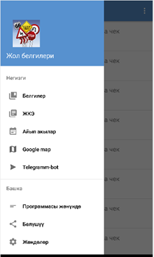
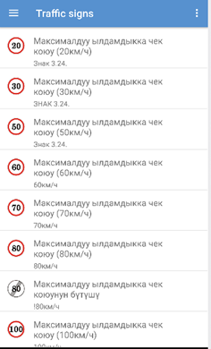
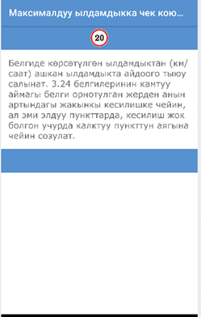
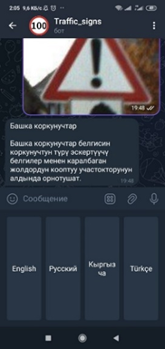
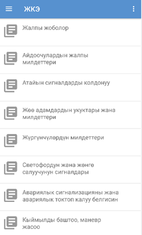
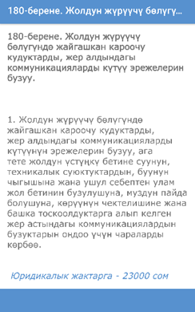
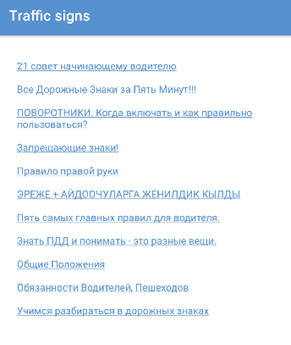
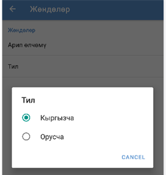

# Traffic Signs — Android app + recognition bot

A helper for people learning road signs and traffic rules, made of two parts that work together:

- **Android app** — a road-sign catalogue, traffic rules and fines in Russian and Kyrgyz. Its "Telegram bot" menu item opens the recognition bot.
- **Telegram bot** — send a photo of a road sign and get its name in English, Russian, Kyrgyz or Turkish. Recognition is done by a CNN trained on GTSRB: **98.97% accuracy** on the official test set.

```
Android app ──(menu: Telegram bot)──► Telegram bot ──► PyTorch CNN (GTSRB, 43 classes) ──► sign name
```

## Screenshots

<table>
  <tr>
    <td align="center"><br>App menu (Kyrgyz)</td>
    <td align="center"><br>Road-sign catalogue</td>
    <td align="center"><br>Sign description</td>
    <td align="center"><br>Bot: language choice and a recognized sign</td>
  </tr>
  <tr>
    <td align="center"><br>Traffic rules</td>
    <td align="center"><br>Fines</td>
    <td align="center"><br>Study materials</td>
    <td align="center"><br>Language: Kyrgyz / Russian</td>
  </tr>
</table>

## Results

| | Accuracy |
|---|---|
| Validation (20% of the training set) | 99.85% |
| **Official GTSRB test set (12,630 images)** | **98.97%** |

Model: 6 convolutional layers with batch normalization and 3 fully connected layers, 50×50 RGB input, trained for 20 epochs with Adam and a linear learning-rate decay.

## Repository

| Folder | What's inside |
|---|---|
| [`bot/`](bot) | Telegram bot (Python), model definition and weights, training notebook `Model.ipynb`, translations — see [bot/README.md](bot/README.md) |
| [`android-app/`](android-app) | Android app (Java) — see [android-app/README.md](android-app/README.md) |

## Stack

Python · PyTorch / torchvision · python-telegram-bot · Java · Android SDK · AndroidX / Material Components
